<!-- Banner animado: versión vertical en pantallas estrechas, horizontal en el resto -->

  <picture>
    <source media="(max-width: 700px)" srcset="./assets/hero-mobile.svg">
    
  </picture>

  
  
  

---

## Quién soy

Desarrollador de aplicaciones web full stack con una base sólida en sistemas y redes. Trabajo como
ingeniero de software en **Softtek**, en proyectos de Inteligencia Artificial para compañías como
ASISA, El Corte Inglés, Banco Santander o el Real Madrid C.F. Lo que hago y cómo lo hago está en
mi [portfolio](https://portfolio-alvaro-swart.vercel.app).

Programo sobre todo con React, Python y PHP, pero lo que de verdad me mueve son la **ciberseguridad**
y la **IA**: automatizar con n8n, exprimir los copilotos y entender el lado defensivo de la red, desde
resolver vulnerabilidades (SQLi, XSS, LFI) hasta configurar proxys inversos, WAF y balanceadores de carga.

## Mis objetivos

- Hacer una especialización y, más adelante, la carrera de **ingeniería en ciberseguridad**.
- Seguir creciendo en proyectos donde la IA y la seguridad se junten de verdad.
- **Trabajar en el extranjero**, en entornos dinámicos donde no deje de aprender.

## Cómo funciono

- Organizado y proactivo, lo que se puede hacer hoy, no lo dejo para mañana.
- Aprendo rápido y con autonomía. Llegué a la IA desde cero y en pocos meses estaba entregando.
- Me gusta el trabajo en equipo y documentar lo que hago para que otro pueda continuarlo.
- Viajar me enseñó mucho: Luxemburgo, Países Bajos, Bélgica y Suecia. De ahí vienen mis ganas de salir fuera.

---

## Tecnologías

**Lenguajes, frameworks y bases de datos**

  

**IA, automatización y herramientas de desarrollo**

  
  
  
  
  
  
  
  
  
  
  
  
  
  
  
  
  
  
  

**Sistemas, redes y seguridad**

  
  
  
  
  
  
  
  
  
  
  
  
  
  
  
  
  
  
  

---

## Experiencia

**Softtek** — Ingeniero de software · Córdoba (desde mayo de 2026)
Proyectos de IA a distintos niveles: integración, experiencia de usuario, generación de código y
conexión con sistemas de diseño. Entré tras mis prácticas en el laboratorio **Innovation Labs** y firmé contrato.

**Universidad de Córdoba** — Prácticas de desarrollo web (mayo de 2025)
Desarrollo con WordPress, programación en PHP y gestión de Active Directory.

**CICAP** — Técnico de redes y sistemas (marzo–junio de 2023)
Mantenimiento de red y equipos, documentación de topologías, despliegue de GLPI, copias de seguridad
automáticas con Duplicati y apoyo en proyectos Arduino con sensores.

---

## Formación

- **Desarrollo de Aplicaciones Web (DAW)** — IES Fidiana · **Matrícula de Honor** (2026)
- **Sistemas Microinformáticos y Redes** — IES Jerez y Caballero · nota final 9,03
- **ESO** — IES Jerez y Caballero · nota final 8,89
- Inglés: comprensión B1–B2

---

## Proyectos

<b>Tengara — Plataforma distribuida de ciberinteligencia (mi TFG)</b>

 

  
  
  
  
  
  
  
  
  
  
  
  

Plataforma de ciberinteligencia (CTI) y defensa activa con arquitectura híbrida edge-cloud, capaz de
capturar, analizar y perfilar ciberataques en tiempo real. Los atacantes impactan contra un VPS público
y, por un túnel SSH inverso, el tráfico se redirige a una Raspberry Pi aislada con **honeypots** (Cowrie
y Krawl), donde creen haber vulnerado un sistema real.

Un script en Python vigila los logs y envía la telemetría por webhook a **n8n**, que cruza la IP con
fuentes OSINT (VirusTotal, Shodan, AbuseIPDB) y pide a un LLM (**Llama 3**) un informe forense. Todo se
centraliza en un dashboard en **React** con un globo 3D de trazabilidad y gráficas de tendencias. Añadí
alertas automáticas a un bot de **Telegram** cuando aparecen payloads destructivos, y un copiloto de IA
que permite auditar la base de datos MySQL preguntando en lenguaje natural.

<b>Generador de Presupuesto Automático con IA</b>

 

  
  

Generador automático de presupuestos (ene. 2026 – feb. 2026). El RFP se procesa y los embeddings quedan guardados para analizar el contexto y la complejidad de cada funcionalidad. En la web se elige el proyecto y el presupuesto completo sale al instante.

- **Desglose técnico**: épicas y tareas separadas en frontend y backend.
- **Equipo y costes**: equipo recomendado (PM, QA y desarrollo) y coste a partir de las horas.
- **Recálculo en tiempo real**: al cambiar la talla de desarrollo (XS–XXL) se actualizan el presupuesto, las métricas y los gráficos. El control de la tarifa horaria media hace lo mismo.
- **Filtros y Excel**: se puede buscar una funcionalidad o filtrar por talla, y exportar de un clic el desglose, las leyendas y el resumen ejecutivo.

<b>DataManager Copilot</b>

 

  
  
  
  
  

Sistema de QA inteligente (mar. 2026 – may. 2026). Asistente dentro de VS Code para buscar, preparar y reservar datos de prueba, en vez de pelearse con las bases de datos a mano.

- **De principio a fin**: lee los requisitos en Jira y comprueba que las APIs del entorno UAT están listas.
- **Reserva inteligente**: localiza los datos y crea bloqueos temporales para que nadie más los pise.
- **Sincronización Git**: commits y pushes automáticos. Si hay un conflicto, actualiza y busca otra alternativa.
- **Conexión directa**: publica la información en las colas de Kafka.
- **Cero alucinaciones**: no inventa comandos, usa herramientas en Node.js y se para a preguntar si falta un dato.

<b>Arquitectura OCR con extracción por IA y control antifraude</b>

 

  
  
  
  
  
  
  
  
  

Arquitectura de extremo a extremo para reembolsos médicos que junta OCR multimodal, validación humana
(HITL) y antifraude en tiempo real.

- **Validación humana con LangGraph**: el grafo se pausa en Redis y el flujo solo avanza cuando la
  persona confirma lo extraído.
- **Tubería única**: la entrada automática y la manual confluyen en el mismo embudo, donde el LLM cruza
  y enriquece los datos. El documento original siempre manda.
- **Antifraude distribuido con n8n**: duplicados exactos por hash, manipulados por similitud vectorial
  (>95 %), geocodificación y validación VIES asíncrona. El backend espera el callback para aprobar,
  revisar o rechazar.
- **Multimodalidad**: Mistral procesa PDFs nativos, escaneados e imágenes y devuelve un esquema JSON
  estricto, con Markdown como respaldo.

<b>Plataforma de auditoría y DevSecOps con IA</b>

 

  
  
  

Arquitectura modular construida con **n8n** y **Google Gemini**. Un orquestador decide la estrategia,
varios flujos coordinados recogen la información, se filtran los falsos positivos con evidencias
técnicas y se puntúan los hallazgos (CVSS). El resultado sale como JSON estructurado y viaja por
webhook a un **frontend en React** que lo convierte en un dashboard interactivo.

<b>Alvi - Mi Asistente Virtual</b>

 

  
  
  
  
  
  
  

Asistente de voz que corre en local y deja el entorno de trabajo listo (sep. 2026 – oct. 2026). No escribe ni modifica el código de las aplicaciones: mueve ventanas, arranca Docker, lee los logs, opera Git, abre aplicaciones y deja un informe para que el editor haga el cambio. Se le habla diciendo «alvi» en cualquier punto de la frase.

- **Modelo local y acotado**: Gemma 4 en Ollama, en la GPU del propio PC, con medio segundo por turno. Solo puede llamar a funciones cerradas: sin shell libre y sin rutas, únicamente proyectos declarados.
- **Acciones con permiso**: matar un puerto, hacer commit o push exige un verbo explícito; una pregunta no autoriza nada. Una frase puede traer varias órdenes y se ejecutan en el orden dicho.
- **Red y arranque**: una Raspberry Pi hace de centinela de red, despierta el PC por Wake-on-LAN y comprueba que ha respondido.
- **Voz y pantalla**: Piper le pone voz en español, los comandos se quedan en el portapapeles listos para pegar y el OCR offline de Windows lee los errores que hay a la vista.

<b>Proxy para Agentes de IA</b>

 

  
  
  
  
  
  
  
  

Proxy de seguridad en tiempo de ejecución (RASP) que se sitúa entre los agentes de IA y el proveedor del modelo (sep. 2026). Funciona como un antivirus para agentes: intercepta el tráfico, compara el significado de los prompts con firmas de ataque y vigila los flujos tóxicos de cada sesión.

- **Filtro de entrada**: un modelo local de intención (Prompt-Guard y Llama Guard 3) decide si cada petición pasa; si no responde, bloquea.
- **Proxy ligero sin Docker**: un binario en Go con ONNX Runtime bloquea credenciales, busca firmas de ataque por embeddings y pasa un clasificador de inyección de prompts.
- **Router**: traduce entre OpenAI y Anthropic y evita que el prompt de sistema se filtre en las respuestas.
- **Cadena de suministro**: un gateway MCP y un analizador (YARA y Frida) auditan skills y servidores MCP y los bloquean o los ponen en cuarentena.
- **Modo sombra**: registra sin bloquear para calibrar los umbrales con tráfico real antes de pasar a bloquear. Pensado para cubrir el OWASP Top 10 de aplicaciones agénticas.

<b>Ingeniería inversa con REA</b>

 

  
  
  
  
  

Prueba de REA, una herramienta que permite a un asistente de IA abrir un programa ya compilado y estudiarlo apoyándose en las herramientas clásicas de análisis (oct. 2026). La puse a prueba con KeePassXC, un gestor de contraseñas de código abierto.

- **Sin código fuente**: reconstruí cómo convierte la contraseña maestra en la llave de la base de datos: huella, derivación lenta de la clave, sello de integridad y cifrado.
- **Acierto medido**: al compararlo después con el código abierto, de 20 conclusiones 18 eran exactas, 2 correctas pero incompletas y ninguna errónea.
- **kdbxlite**: con lo aprendido creé una aplicación propia que abre, lee y crea bases de datos que el KeePass original acepta, y al revés.
- **Interfaz web**: abre una caja fuerte, muestra u oculta las contraseñas, crea entradas y explica lo que pasa por dentro en cada paso.

Informe: [Descargar PDF](https://portfolio-alvaro-swart.vercel.app/recursos/documentos/rea-keepass.pdf)

<b>Entornos OWASP: Broken Web Applications y WebGoat</b>

 

  
  
  
  
  
  

Dos prácticas de 2.º de DAW con máquinas vulnerables a propósito, una desde el lado del defensor y otra desde el del atacante.

- **OWASP Broken Web Applications**: montada en VMware, documenté en DVWA el XSS reflejado y el almacenado, la inyección SQL, la inyección SQL a ciegas (explotada con sqlmap hasta sacar el usuario, la base de datos y sus tablas) y la inclusión de archivos local y remota.
- **Corrección**: en cada una expliqué por qué el código era vulnerable y lo corregí con escape de caracteres, consultas parametrizadas, `allow_url_include` desactivado y una lista blanca. Cierra con un repaso del OWASP Top 10.
- **WebGoat**: ataqué las mismas vulnerabilidades con Burp Suite: interceptar el login para saltarse el `maxlength` y entrar como administrador, y sacar un nombre carácter a carácter con Intruder y una inyección a ciegas.

Informes: [OWASP BWA (PDF)](https://portfolio-alvaro-swart.vercel.app/recursos/documentos/owasp-bwa.pdf) · [WebGoat (PDF)](https://portfolio-alvaro-swart.vercel.app/recursos/documentos/webgoat.pdf)

<b>Juego Pokémon</b>

 

  
  
  
  

Combate por turnos en el navegador para la asignatura de desarrollo web en entorno cliente. Cada jugador elige un equipo de tres Pokémon y, en el combate, ataca, usa la mochila (pociones) o huye. El daño tiene en cuenta el tipo, el ataque y la defensa.

Repositorio: [juegoPokemonAlvaro](https://github.com/alvaro-tena/juegoPokemonAlvaro)

<b>WhatsApp Web</b>

 

  
  
  
  

Clon de la interfaz de WhatsApp Web para la asignatura de diseño. La columna de chats, la búsqueda y la conversación abierta van en la misma pantalla, con burbujas de mensajes y notas de voz. Los usuarios y los mensajes se guardan en Supabase.

Repositorio: [whatsappWeb](https://github.com/alvaro-tena/whatsappWeb)

---

## Contacto

- Portfolio: [portfolio-alvaro-swart.vercel.app](https://portfolio-alvaro-swart.vercel.app)
- LinkedIn: [Álvaro Tena García](https://www.linkedin.com/in/%C3%A1lvaro-tena-garc%C3%ADa-14662a182)
- Correo: [alvarotg2006@gmail.com](mailto:alvarotg2006@gmail.com)

<i>Si buscas a alguien motivado, responsable y con muchas ganas de aprender, contacta conmigo!!</i>

